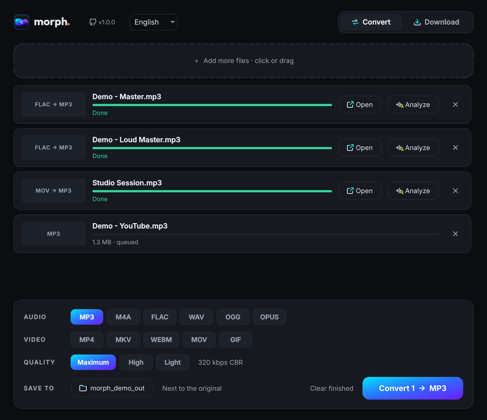
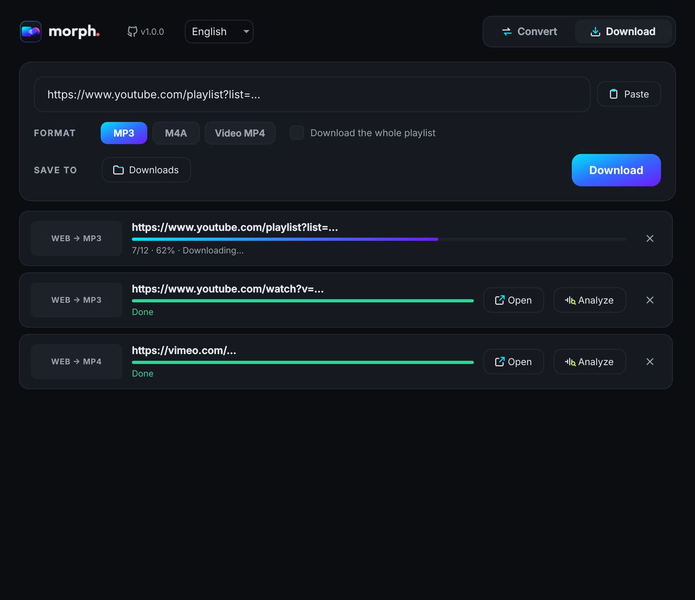

<p align="center">
  <picture>
    <source media="(prefers-color-scheme: dark)" srcset="docs/img/logo_for_dark.png">
    
  </picture>
</p>

<h3 align="center">Convert and download audio and video. Any format. Simple.</h3>

<p align="center">
  A format converter for Windows that also downloads from YouTube and 1000+ sites.<br>
  Drop a file, pick a format, done. FFmpeg is built in; there is nothing to set up.
</p>

<p align="center">
  <a href="https://github.com/stgermanrobert/morph/releases/latest"></a>
  <a href="https://github.com/stgermanrobert/morph/releases"></a>
  
  
  <a href="LICENSE"></a>
  <a href="https://github.com/stgermanrobert/morph/actions/workflows/build.yml"></a>
</p>

<p align="center">
  <a href="https://github.com/stgermanrobert/morph/releases/latest"><b>⬇&nbsp; Download for Windows</b></a>
  &nbsp;·&nbsp; <a href="#formats">Formats</a>
  &nbsp;·&nbsp; <a href="#development">Development</a>
</p>

<table>
  <tr>
    <td></td>
    <td></td>
  </tr>
</table>

## Features

**Convert**
- Drop files or **whole folders** and pick a format. Several files convert at once, with real progress and speed.
- **Instant, lossless remux** whenever possible (MOV H.264 → MP4, for example). If a remux fails, Morph re-encodes on its own.
- Three quality levels per format, each showing the exact setting it will use ("320 kbps CBR", "H.264 CRF 21"…).

**Download**
- **YouTube, SoundCloud, Vimeo and 1000+ sites** through [yt-dlp](https://github.com/yt-dlp/yt-dlp), as **MP3** with cover art and tags, **M4A** or **MP4 video**. Whole playlists work too.

**Built to work with [Oído](https://github.com/stgermanrobert/oido)**
- Every finished file has an **Analyze** button that opens it in Oído, its sister app, to see the spectrogram and the **real quality**: how much YouTube trimmed off, for instance.

**Interface in English, Spanish and Russian**, switchable from the header.

## Formats

| | Output formats | Notes |
|---|---|---|
| **Audio** | MP3 · M4A (AAC) · FLAC · WAV · OGG (Vorbis) · OPUS | Maximum / High / Light; FLAC is always lossless |
| **Video** | MP4 · MKV · WEBM · MOV · GIF | Lossless remux when the codecs fit; otherwise H.264/AAC or VP9/Opus |
| **Input** | Virtually any audio or video file FFmpeg can read | |

## Download and install

1. Get **`Morph-Setup-x.y.z.exe`** from [Releases](https://github.com/stgermanrobert/morph/releases/latest).
2. Run it. It installs **for your user only, without admin rights**. The language you pick in setup becomes the app's language.
3. That's it. **FFmpeg, yt-dlp and Deno are bundled**: there is nothing else to install.

> **"Windows protected your PC"**: the installer is not signed with a commercial certificate. Click **More info → Run anyway**. Each Release publishes `SHA256SUMS.txt` so you can verify the file.

Prefer not to install? Get **`Morph-x.y.z-portable-win64.zip`** and open `Morph.exe`.

> **About downloads:** use Morph for content you have the right to download: your own uploads, freely licensed material, or anything the author allows. Audio from YouTube is already compressed. Saving it at "Maximum" quality can't bring back what YouTube discarded, and Oído will show you exactly that.

## Development

```powershell
git clone https://github.com/stgermanrobert/morph
cd morph
py -m pip install -r requirements.txt
winget install Gyan.FFmpeg DenoLand.Deno   # only needed to run from source
py src/morph.py
```

**Translations.** English is the source language; Spanish and Russian live in [`src/locales.py`](src/locales.py). `py tools/i18n_check.py` fails if any string is missing or a placeholder doesn't match, and CI runs it on every build.

**Automated builds.** Every `v*` tag triggers the [GitHub Actions workflow](.github/workflows/build.yml) on Windows:
1. Checks that every translation is complete.
2. Builds with PyInstaller and bundles FFmpeg (static GPL build by [BtbN](https://github.com/BtbN/FFmpeg-Builds)) and [Deno](https://deno.com), which yt-dlp needs for YouTube.
3. Runs a self-test of the `.exe` (`Morph.exe --selftest`) that converts audio and video with the bundled FFmpeg.
4. Builds the installer with Inno Setup, then installs it, tests it and uninstalls it.
5. Publishes the Release with the installer, the portable ZIP and checksums.

```
src/
  morph.py          interface and engine (PySide6 + FFmpeg + yt-dlp)
  locales.py        Spanish and Russian catalogs
  i18n.py           language selection and tr()
  ui_icons.py       vector UI icons
  app_runtime.py    paths, bundled binaries, typeface, taskbar icon
packaging/          PyInstaller, Inno Setup, installer artwork
tools/              translation checker
```

## Credits and licenses

Morph source code: **MIT** © 2026 [Germán Robert](https://github.com/stgermanrobert).

Morph is built on [FFmpeg](https://ffmpeg.org), [yt-dlp](https://github.com/yt-dlp/yt-dlp), [Deno](https://deno.com), [Qt for Python (PySide6)](https://www.qt.io/qt-for-python) and the [Inter](https://rsms.me/inter/) typeface. The binary package includes **GPL** components (FFmpeg, mutagen). Details in [THIRD_PARTY_NOTICES.md](THIRD_PARTY_NOTICES.md).
